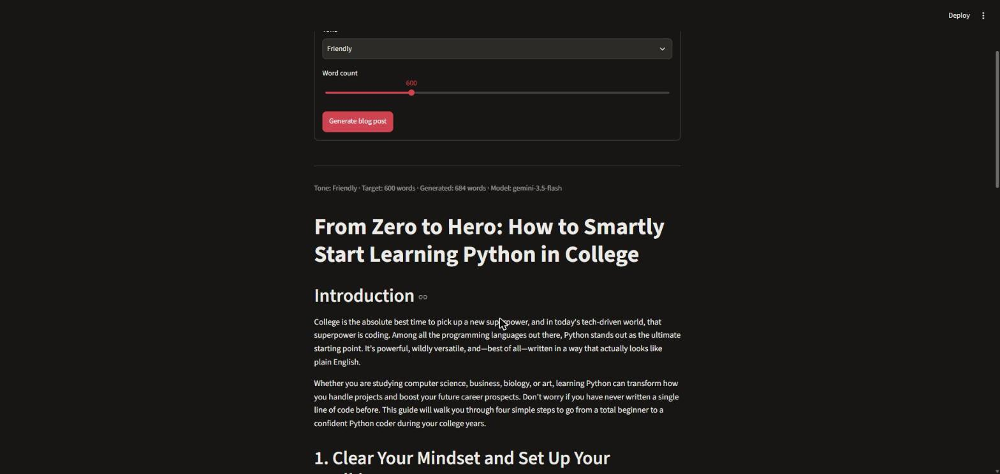
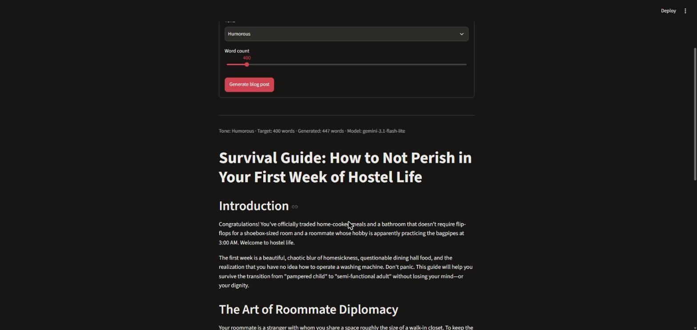

# Blog Post Generator (LLM Mini Project – PS 4)

A Streamlit web app that uses Google Gemini to turn a **topic**, a **tone** and a **target word count** into a structured blog post with a title, an introduction, headed sections and a conclusion. You can download the post as a Markdown file.

## Problem statement

Students struggle to start writing blogs. This app generates a structured blog post (title, intro, sections, conclusion) from a topic and a tone chosen by the user, which gives them a solid first draft to edit and build on.

## Features

- Inputs: a topic text box, a **tone dropdown** (Professional, Casual, Friendly, Informative, Humorous, Persuasive) and a **word-count slider** (300–1500)
- A structured prompt makes the model always return `# Title`, `## Introduction`, 3–5 headed sections and `## Conclusion`. The number of sections scales with the word count.
- The post is rendered in the page with a line showing the tone, the target length, the actual word count and the model used
- **Download as Markdown (.md)** button
- Model fallback: if one Gemini model is busy or slow, the app automatically tries the next one

## Tech stack

| Part | Used |
|---|---|
| Language | Python 3.12 |
| LLM | Google Gemini (`gemini-3.1-flash-lite`, with fallback to `gemini-3.5-flash` / `gemini-3.8-flash`) via the `google-genai` SDK |
| UI | Streamlit |
| Config | `python-dotenv` (API key in `.env`) |

## How to run

1. Clone the repo and open the folder:
   ```bash
   git clone <this-repo-url>
   cd <repo-folder>
   ```
2. (Optional) Create a virtual environment:
   ```bash
   python -m venv venv
   venv\Scripts\activate        # Windows
   source venv/bin/activate     # macOS / Linux
   ```
3. Install the dependencies:
   ```bash
   pip install -r requirements.txt
   ```
4. Get a free Gemini API key from https://aistudio.google.com/apikey. Copy `.env.example` to `.env` and paste your key:
   ```
   GEMINI_API_KEY=your_gemini_api_key_here
   ```
5. Start the app:
   ```bash
   streamlit run app.py
   ```
   It opens at http://localhost:8501.

## Prompt design

- **System instruction:** "You are an experienced blog writer who helps students start writing blogs. You write clear, original, well-structured posts in Markdown."
- **User prompt:** the topic, the tone and the target length (with a ±10% limit), plus an exact Markdown skeleton (`# Title` → `## Introduction` → N headed sections → `## Conclusion`). It adds these rules: keep the tone consistent, don't invent statistics or quotes, and output only the post.
- **Settings:** temperature 0.8 for some creativity, with model "thinking" turned off. Thinking isn't needed for blog writing, and turning it off made responses much faster.

## Sample tests

| # | Topic | Tone | Target | Generated |
|---|---|---|---|---|
| 1 | How to start learning Python in college | Friendly | 600 | 684 |
| 2 | Benefits of a morning routine for students | Informative | 500 | 561 |
| 3 | Why every engineering student should learn public speaking | Persuasive | 800 | 808 |
| 4 | Surviving your first week of hostel life | Humorous | 400 | 447 |
| 5 | The impact of AI on the future of jobs | Professional | 1000 | 1152 |

## Screenshots




## Project structure

```
app.py              # Streamlit app: prompt building, Gemini call, UI
requirements.txt    # Python dependencies
.env.example        # template for the API key (the real .env is git-ignored)
screenshots/        # outputs from the 5 sample tests
```
